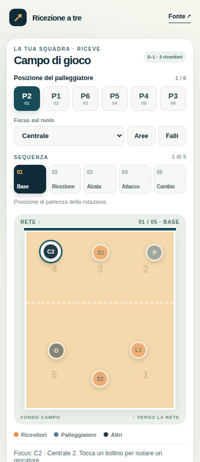

# Ricezione a tre — mobile prototype

A small, Italian-language viewer for the six rotations and five receive-side phases of the built-in **ricezione-a-3** scheme in [napo/rotazionivolley](https://github.com/napo/rotazionivolley). The three main receivers are S1, S2 and L1; the source also assigns some short-ball coverage to other players. Player coordinates, libero substitutions, and reception competence polygons come directly from its JSON file. This prototype does not add coaching positions or other formations.



[View the competence and positional-fault overlays](preview/overlays.png).

## Try it

```bash
python3 -m http.server 8000
```

Open `http://localhost:8000` on a computer or, using the computer's local IP address, on a phone on the same network. Rotations run P2 → P1 → P6 → P5 → P4 → P3. Choose a phase beside the court, or swipe left/right on the court. The role selector defaults to **Centrale** and highlights the active central. Selecting **Schiacciatore** highlights both hitters; tapping either marker focuses that player alone.

**Aree** shows the selected role's stored reception polygons and claimed shared borders. **Falli** shows the selected role's adjacent rotation relationships. Either button switches to **Ricezione**, the only phase where these overlays apply; choosing another phase closes them. The fault check follows the source app's model: it compares marker centers at the opposing service contact. Actual positional faults depend on players' feet. The URL retains the rotation, phase, role, and active overlays.

## Source and licence

`references/rotazionivolley/ricezione-a-3.json` is an unmodified copy from upstream revision `d9e457ee05a2e57f3a7b86a0b176a2bc82d9352e` (release 2.5.2). See [NOTICE.md](references/rotazionivolley/NOTICE.md) for attribution. This prototype is provided under [AGPL-3.0-or-later](LICENSE); the position data also retains the original Apache 2.0 attribution described in the notice.
